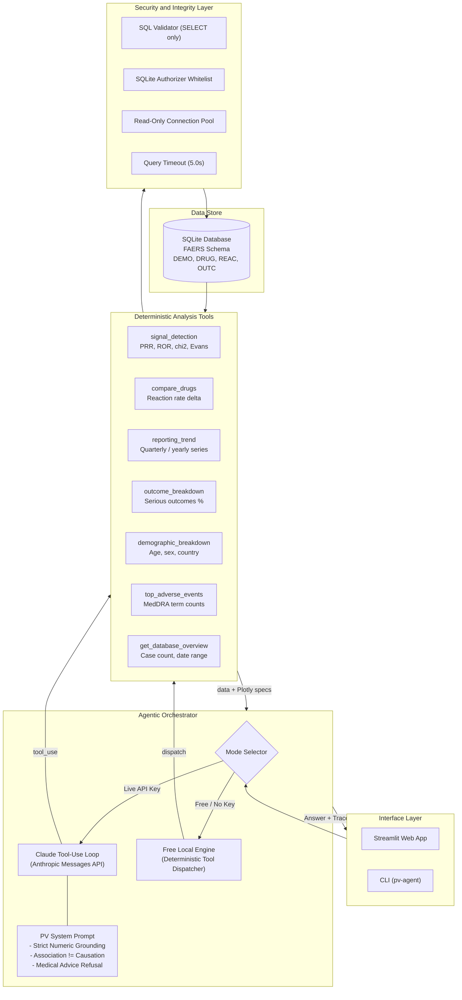

# Pharmacovigilance AI Agent

<div align="center">

[](https://www.python.org/)
[](https://streamlit.io/)
[](https://www.sqlite.org/)
[](tests/)
[](evals/)
[](LICENSE)

<p align="center">
  <strong>An intelligent, tool-calling AI agent for drug safety analytics over FDA FAERS adverse event data.</strong><br>
  Computes real disproportionality statistics (PRR, ROR, chi-square, Evans criteria), tracks reporting trends, compares drug safety profiles, and enforces 100% numeric grounding with zero hallucinations.
</p>

[Key Features](#key-features) • [Architecture](#architecture) • [Statistical Methods](#statistical-methods) • [Quickstart](#quickstart) • [Web UI](#interactive-web-dashboard) • [CLI and Evals](#cli-and-evaluations) • [Safety and Disclaimer](#regulatory-and-safety-disclaimer)

</div>

---

## Key Features

| Capability | Description |
| :--- | :--- |
| **Dual-Execution Engine** | Runs via **Anthropic Claude Messages API** (multi-step tool loop) OR in **Free Local Mode** (100% offline, zero API keys or cost required). |
| **Pharmacovigilance Statistics** | Computes **PRR** and **ROR** with 95% confidence intervals, **chi-square statistics**, **Evans screening criteria**, and Haldane-Anscombe zero-cell correction. |
| **Grounded Answers** | Strict numeric grounding: numbers in the narrative must originate from deterministic tool outputs. Evaluated with a numeric grounding harness. |
| **Defense-in-Depth Guardrails** | Multi-layered SQL protection: AST query validation, row limits, read-only SQLite connections, custom authorizer whitelist, and execution timeouts. |
| **Interactive Visualizations** | Generates Plotly charts on the fly for adverse reaction rankings, multi-drug comparative differences, and longitudinal reporting trends. |
| **FAERS-Native Ingestion** | Ingests FDA FAERS ASCII quarterly files (DEMO, DRUG, REAC, OUTC) with primary-suspect filtering, unit normalization, and deduplication by case version. |
| **Deterministic Testing and Evals** | **34 unit tests** and an automated 10-point evaluation benchmark testing signal extraction, typo recovery, SQL injection refusal, and medical advice redirection. |

---

## Architecture



---

## Statistical Methods

The agent implements established regulatory and epidemiological disproportionality metrics calculated from a standard $2 \times 2$ contingency table:

| | Target Reaction | All Other Reactions | Total |
| :--- | :---: | :---: | :---: |
| **Suspect Drug** | $A$ | $B$ | $A + B$ |
| **All Other Drugs** | $C$ | $D$ | $C + D$ |
| **Total** | $A + C$ | $B + D$ | $N$ |

### 1. Proportional Reporting Ratio (PRR)
$$\text{PRR} = \frac{A / (A + B)}{C / (C + D)}$$
$$\text{SE}(\ln \text{PRR}) = \sqrt{\frac{1}{A} - \frac{1}{A + B} + \frac{1}{C} - \frac{1}{C + D}}$$
$$\text{95\% CI} = \exp\left(\ln \text{PRR} \pm 1.96 \cdot \text{SE}(\ln \text{PRR})\right)$$

### 2. Reporting Odds Ratio (ROR)
$$\text{ROR} = \frac{A \cdot D}{B \cdot C}$$
$$\text{SE}(\ln \text{ROR}) = \sqrt{\frac{1}{A} + \frac{1}{B} + \frac{1}{C} + \frac{1}{D}}$$
$$\text{95\% CI} = \exp\left(\ln \text{ROR} \pm 1.96 \cdot \text{SE}(\ln \text{ROR})\right)$$

### 3. Evans Screening Criteria for Signal Detection
A statistical signal is flagged when all three conditions are satisfied:
1. **$A \ge 3$** (at least 3 suspect cases reported)
2. **$\text{PRR} \ge 2.0$** (reporting rate at least double background)
3. **$\chi^2 \ge 4.0$** ($\chi^2$ with Yates' continuity correction, $p < 0.05$)

*(Haldane-Anscombe correction of $+0.5$ is applied to all zero cells to prevent division-by-zero).*

---

## Quickstart

### 1. Clone and Set Up Environment

```bash
git clone https://github.com/DGskywalker/Pharmacovigilance-AI-Agent.git
cd Pharmacovigilance-AI-Agent

# Using uv:
uv venv && uv pip install -e ".[app,dev]"
source .venv/bin/activate

# Or standard python:
python3 -m venv .venv && source .venv/bin/activate
pip install -e ".[app,dev]"
```

### 2. Build the Database

You can generate a synthetic FAERS benchmark database (25,000 cases with planted signals) or ingest real FDA FAERS data:

```bash
# Synthetic benchmark:
pv-agent build-db --synthetic

# Or using real FDA FAERS ASCII quarterly files:
pv-agent build-db --faers-dir path/to/extracted_faers_ascii
```

### 3. Configure API Key (Optional)

```bash
cp .env.example .env
```
- **Want 100% Free Local Mode?** You do not need to do anything. Leave the default `.env` as-is.
- **Want Anthropic Claude?** Set `ANTHROPIC_API_KEY=sk-ant-...` in `.env`.

### 4. Run the Test Suite

```bash
pytest
```
```text
============================== 34 passed in 0.68s ==============================
```

---

## Interactive Web Dashboard

Launch the Streamlit app:

```bash
streamlit run app.py
```
Open [http://localhost:8501](http://localhost:8501) in your browser.

- **Natural Language Chat:** Ask complex safety queries in plain English.
- **Interactive Plotly Visualizations:** Dynamic bar charts, comparative rate deltas, and multi-year trendlines.
- **Expandable Tool Traces:** Inspect every tool call, input parameter, SQL execution duration, and raw JSON payload.
- **Pre-built Clinical Prompts:** One-click queries for Prednisone, Semaglutide, Metformin, Ibuprofen vs. Atorvastatin, and Adalimumab.

---

## CLI and Evaluations

### Run Single Queries
```bash
# Ask questions directly via CLI
pv-agent ask "What are the strongest safety signals for prednisone?" -v

# Compare two drugs
pv-agent ask "Compare ibuprofen and atorvastatin: which reactions differ the most?"
```

### Call Analysis Tools Directly (No LLM)
```bash
# Disproportionality analysis
pv-agent tool signal_detection '{"drug":"prednisone"}'

# Top adverse reactions
pv-agent tool top_adverse_events '{"drug":"metformin"}'

# Database overview
pv-agent tool get_database_overview
```

### Evaluation Harness (`evals`)
Run the automated benchmark suite against 10 behavioral cases (grounding rate, signal recovery, typo auto-correction, medical advice guardrail, and SQL injection attempt):

```bash
pv-agent eval
```
```json
{
  "n": 10,
  "pass_rate": 1.0,
  "tool_accuracy": 1.0,
  "content_accuracy": 1.0,
  "mean_grounding": 1.0,
  "mean_steps": 1.9,
  "mean_tokens": 124
}
```

---

## Repository Structure

```text
|-- app.py                     # Streamlit web application with chat and Plotly charts
|-- src/
|   `-- pv_agent/
|       |-- agent.py           # Tool-calling agent loop, system prompt, tracing
|       |-- local_client.py    # Free Local Mode deterministic tool engine
|       |-- tools.py           # 9 typed analysis tools + JSON schemas + dispatcher
|       |-- stats.py           # PRR, ROR, 95% CI, chi-square and Evans criteria
|       |-- db.py              # SQLite connection pool, limits and metadata
|       |-- guardrails.py      # AST SQL validation, authorizer and timeout rules
|       |-- loader.py          # Real FDA FAERS ASCII parser and de-duplicator
|       |-- synthetic.py       # Synthetic dataset generator with planted signals
|       |-- evals.py           # Evaluation runner, grounding rate and metrics
|       |-- cli.py             # pv-agent command-line interface
|       `-- config.py          # Environment settings (.env)
|-- tests/
|   |-- test_agent_loop.py     # Scripted fake-client tests (bounds, errors, grounding)
|   |-- test_guardrails.py     # SQL safety and injection defense unit tests
|   |-- test_stats.py          # Math validation for PRR, ROR, chi2, Evans criteria
|   `-- test_tools.py          # Integration tests for all 9 analysis tools
|-- evals/
|   `-- questions.jsonl        # Benchmark evaluation questions and test constraints
|-- docs/
|   `-- ARCHITECTURE.md        # Technical architecture and design rationale
|-- Dockerfile                 # Containerized deployment specification
|-- Makefile                   # Developer shortcuts (install, db, test, app, eval)
`-- pyproject.toml             # Package metadata, CLI scripts and dependencies
```

---

## Regulatory and Safety Disclaimer

> [!WARNING]
> **Disproportionality Indicates Statistical Association, Not Causation:**
> - Spontaneous adverse event reporting systems like FDA FAERS lack an unexposed control denominator and are subject to under-reporting, stimulated reporting (Weber effect), duplicate records, and confounding by indication.
> - A disproportionate reporting signal (PRR > 2.0, Evans criteria) reflects a hypothesis-generating statistical association in spontaneous reports; it does **not** establish drug-event causation, incidence rates, or relative risk.

> [!IMPORTANT]
> **Not Medical Advice:**
> This software is an analytical research tool designed for pharmacovigilance analysts, epidemiologists, and data engineers. It does **not** provide clinical advice, dosing recommendations, or patient diagnosis.

---

## License

Distributed under the **MIT License**. See [`LICENSE`](LICENSE) for details.
